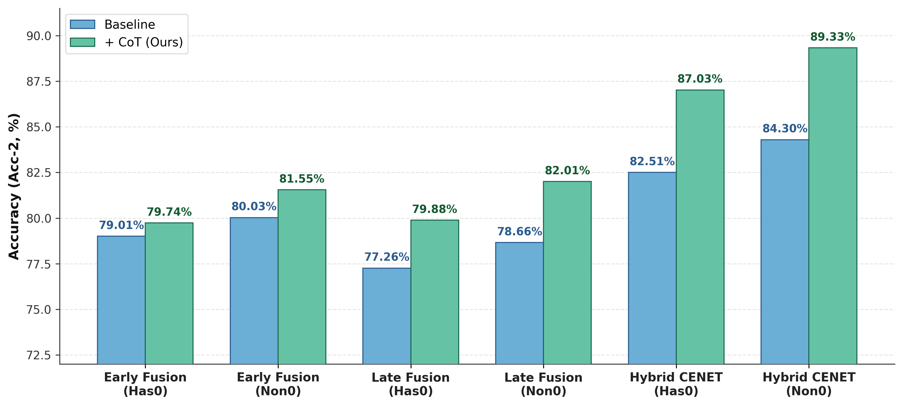
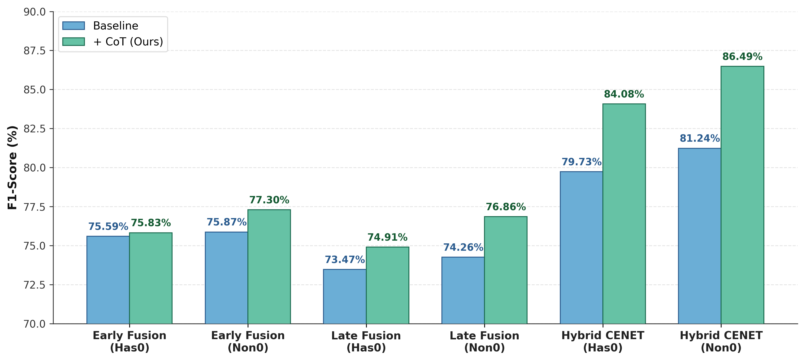

# Multimodal Sentiment Analysis with Chain-of-Thought Reasoning on CMU-MOSI


Official PyTorch implementation for **Multimodal Sentiment Analysis with Chain-of-Thought (CoT) Reasoning on CMU-MOSI**, evaluating three standard multimodal fusion paradigms (**Early**, **Late**, and **Hybrid CENET**) alongside their CoT-enhanced variants.

## Experimental Results on CMU-MOSI (Test Set, N = 686)

| Model | Has0_Acc2 | Has0_F1 | Non0_Acc2 | Non0_F1 | Corr |
| :--- | :---: | :---: | :---: | :---: | :---: |
| Early Fusion (EF-DNN) | 79.01% | 75.59% | 80.03% | 75.87% | 0.6946 |
| Early Fusion + CoT | 79.74% | 75.83% | 81.55% | 77.30% | 0.6823 |
| Late Fusion (LF-DNN) | 77.26% | 73.47% | 78.66% | 74.26% | 0.6513 |
| Late Fusion + CoT (PEAR-CoT + CMFF) | 79.88% | 74.91% | 82.01% | 76.86% | 0.6895 |
| Hybrid CENET | 82.07% | 79.26% | 83.99% | 80.94% | 0.7817 |
| **Hybrid CENET + CoT (Ours)** | **87.03%** | **84.14%** | **89.33%** | **86.54%** | **0.8405** |

## Performance Comparison



## Qualitative Case Studies on CMU-MOSI (Test Set)

Examples where the baseline **Hybrid CENET** misclassifies sentiment polarity due to sarcasm, quantitative scoring, or idioms, and our **Hybrid CENET + CoT** successfully calibrates the prediction:

| ID | Utterance | $I_{\text{audio}}$ | $I_{\text{vision}}$ | $\hat{y}_{\text{CENET}}$ | $\hat{y}_{\text{CoT}}$ | $\hat{y}_{\text{final}}$ | $y_{\text{true}}$ |
| :--- | :--- | :---: | :---: | :---: | :---: | :---: | :---: |
| **#18** | *"HE UM HAD ALL THE CHARM OF A NARCISSIST..."* | 0.105 | 0.032 | +1.07 | -2.00 | **-0.98** | -2.80 |
| **#122** | *"SO SEASON OF THE WITCH IS RATED 3 OUT OF 10"* | 0.071 | 0.017 | +1.56 | -2.00 | **-0.83** | -2.50 |
| **#43** | *"AND OH OH MY GOSH I WAS BLOWN AWAY"* | 0.048 | 0.017 | -1.69 | +2.00 | **+0.99** | +2.80 |

## Repository Structure

```text
CMU-MOSI-Multimodal-CoT/
├── .gitignore
├── README.md
├── requirements.txt
├── data/
│   └── README.md
├── src/
│   ├── utils.py
│   ├── models.py
│   ├── train_and_cot.py
│   └── evaluate.py
├── notebooks/
│   └── CMU_MOSI_Multimodal_CoT.ipynb
└── results/
    ├── predictions/
    ├── contrastive_cot_validation_results.csv
    ├── paper_5_metrics_results.csv
    ├── paper_5_metrics_results.xlsx
    ├── acc2_comparison_paper.png
    ├── acc2_comparison_paper.pdf
    ├── f1_comparison_paper.png
    └── f1_comparison_paper.pdf
```

## Quick Start

### 1. Installation
```bash
git clone https://github.com
cd CMU-MOSI-Multimodal-CoT
pip install -r requirements.txt
```

### 2. Reproduce Tables & Charts Instantly
```bash
python src/evaluate.py
```

### 3. Train & Run CoT Inference from Scratch
Place `unaligned_50.pkl` inside `data/` and run (conducted on a single NVIDIA Tesla T4 GPU):
```bash
python src/train_and_cot.py
```
